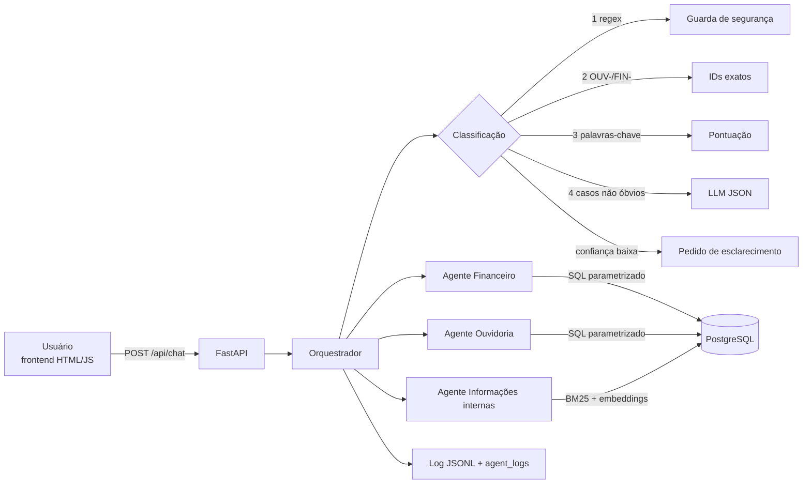

# Arquitetura, decisões técnicas e limitações

## Visão geral

Fluxo de uma pergunta (`app/orchestrator.py`):

0. **Contextualização** (`app/context.py`): se houver histórico e a mensagem parecer continuação, ela é reescrita
   como pergunta completa (ver "Memória curta" abaixo).
1. **Classificação** (`app/router.py`) devolve `dominio`, `confianca`, `metodo` e `justificativa`.
2. O orquestrador chama o agente do domínio, a guarda de segurança, o pedido de esclarecimento ou a resposta de
   fora de escopo.
3. Mede a latência e grava o log (`app/interaction_log.py`).
4. Devolve resposta, fontes, IDs consultados, tabela (quando houver) e detalhes técnicos para o frontend.

## Orquestrador

A classificação é **em camadas, da mais barata e exata para a mais flexível**:

| Ordem | Mecanismo | Exemplo | Resultado |
|---|---|---|---|
| 1 | Guarda de segurança (regex): credencial ou dado pessoal **+** terceiro | "senha de outro colaborador", "holerite do meu colega" | `seguranca` (recusa, conf. 0,95) |
| 2 | Identificador exato | `OUV-0002`, `FIN-0010` | ouvidoria / financeiro (0,99) |
| 3 | Pontuação ponderada por palavras-chave nos três domínios | "férias", "orçamento", "manifestação" | domínio com maior pontuação |
| 4 | LLM com saída JSON (`dominio`, `confianca`, `candidatos`) | "E o reembolso de viagens, quanto saiu?" | decide quando as regras não são inequívocas |
| 5 | Limiar (`ROUTER_MIN_CONFIDENCE`, padrão 0,6) | — | abaixo dele → `ambigua` com botões de domínio |

- Se as palavras-chave são inequívocas (confiança ≥ 0,85, isto é, termos fortes de um só domínio), o LLM **não é
  chamado**: economiza custo e latência e torna os casos comuns determinísticos.
- Se o LLM falha ou devolve um domínio inválido, o roteamento volta às palavras-chave (`palavras-chave (fallback)`)
  e o erro fica no log.
- O prompt do LLM explicita a fronteira mais confusa do conjunto: **regra/processo** (ex.: "quem aprova compra de
  R$ 12.000") é informação interna; **valor registrado** é financeiro.
- Depois de um pedido de esclarecimento, o usuário escolhe o domínio num botão, e a pergunta é reenviada com
  `dominio` forçado (`metodo = escolha_do_usuario`).

## Memória curta (`app/context.py`)

O frontend guarda as últimas trocas (pergunta interpretada, domínio e início da resposta) e envia as 3 mais
recentes em `historico`. Uma mensagem é tratada como **continuação** quando começa com marcadores como "e", "e se",
"mas", "e em", contém referências ("isso", "esse", "anterior") ou é curta e sem termos de nenhum domínio. Perguntas
completas ("Como solicito férias?") passam direto, sem custo de LLM.

- **Com LLM**: o modelo recebe o histórico e devolve `{"continuacao", "pergunta"}`; a pergunta reescrita segue para
  o orquestrador e aparece na UI como "Entendi como: …". Ex.: "E se eu quiser de 6000?" → "Quais são as aprovações
  para uma compra de R$ 6.000?".
- **Sem LLM / falha**: a mensagem é concatenada à pergunta anterior, o que normalmente leva ao mesmo domínio e aos
  mesmos documentos. É uma aproximação (ver limitações).
- Pedidos de esclarecimento não entram no histórico; o botão de domínio reenvia a mesma pergunta com o mesmo contexto.
- "Nova conversa" limpa o histórico.

## Agente Financeiro (`app/agents/financeiro.py`)

Segue a orientação do pacote: *"consultas agregadas e filtros devem usar SQL/Python determinístico"* e *"não
execute SQL arbitrário gerado pelo modelo"*.

1. **Extração de parâmetros**: com LLM, o modelo devolve um JSON (operação, tipo, status, departamentos,
   categorias, centros de custo, período, campo de data, agrupamento, ordem, limite). O JSON passa por
   **validação estrita**: operações e dimensões de uma lista fechada, valores comparados ao vocabulário real do
   banco e datas ISO coerentes. Qualquer valor fora do domínio descarta a extração do LLM e usa o **parser por
   regras** (que também é o caminho sem LLM).
2. **Execução**: sete operações pré-definidas — `total`, `agrupar`, `maiores_lancamentos`, `orcamento`,
   `execucao_orcamentaria`, `inadimplencia` e `lancamento` — com SQL fixo, filtros como parâmetros
   (`%s`/`ANY(%s)`) e colunas vindas de dicionários internos, nunca da entrada.
3. **Sem alvo, sem consulta**: se a pergunta não tem termo financeiro nem filtro concreto (ou o LLM devolve
   `nao_identificado`), o agente pede esclarecimento com exemplos em vez de "chutar" uma consulta. Isso vale mesmo
   quando o usuário força o domínio financeiro.
4. **Resposta por template**, com valores `NUMERIC` → `Decimal` formatados em BRL e o **critério usado** escrito
   por extenso (tipo, status, período, campo de data).

Regras de `indicadores_e_regras.json` aplicadas: "pagas" ⇒ `status = Pago`; despesas sem status ⇒ "incorridas"
(todas), com aviso explícito; competência ≠ vencimento ("vencimento" na pergunta troca o campo); execução
orçamentária = despesas pagas ÷ orçamento do mesmo período e centro de custo; inadimplência = receitas atrasadas ÷
receitas.

## Agente de Informações internas (`app/agents/interno.py`, `app/rag.py`)

- **Chunking** (`app/ingest.py`): cada Markdown é dividido pelas seções `##` (os documentos são curtos, então a
  seção preserva o sentido); cada item de `faq_interno.json` vira um chunk próprio, apontando para o documento de
  origem. Metadados: `domain`, `source`, `document_version`. O aviso padrão "Documento fictício…" é removido do
  texto, mas a versão vai para os metadados.
- **Recuperação híbrida**: BM25 implementado em Python (com normalização sem acentos, stopwords e radical simples)
  + similaridade de cosseno dos embeddings OpenAI, com pesos 50/50. Os embeddings ficam **persistidos** na tabela
  `rag_chunks` e só são recalculados quando o conteúdo do chunk muda (hash SHA-256).
- **Limiar de relevância**: sem trecho relevante, a resposta diz que a informação não consta e indica o canal (RH/TI),
  sem chamar o LLM.
- **Geração**: o LLM recebe **somente** os trechos recuperados e instruções para não inventar, respeitar os
  "limites do agente" dos documentos e citar `Fonte: arquivo.md`. Sem LLM (ou se ele falhar), a resposta é
  **extrativa**: o item de FAQ correspondente e o trecho do documento.

## Agente de Ouvidoria (`app/agents/ouvidoria.py`)

- **Protocolo**: regex `OUV-NNNN` e `SELECT ... WHERE protocolo = ANY(%s)`. Sem correspondência exata ⇒ "não foi
  encontrado" (regra 1 de `referencia_ouvidoria.json`). A extração de protocolos nunca passa pelo LLM.
- **Referência**: "quais status/prioridades/categorias existem" é respondido a partir de
  `referencia_ouvidoria.json`, listando apenas os valores enumerados.
- **Contagem, listagem e tempo de resposta**: filtros por status, categoria, prioridade, canal e período de
  abertura. "Em aberto/pendentes" = Aberto + Em análise + Aguardando área responsável.
- Respostas sempre separam data de abertura e de resposta, avisam que "Respondido ≠ Concluído" e que o prazo de 10
  dias é fictício. Perguntas sobre identidade do manifestante são respondidas com o aviso de que a base não contém
  esses dados.

## Dados e ingestão (`app/ingest.py`)

- Esquema: `data/sql/schema.sql` (fornecido, sem alterações) + `app/sql/extra.sql` (`rag_chunks`, `agent_logs`).
- CSV lidos com `utf-8-sig` (os arquivos têm BOM), valores convertidos para `Decimal`, datas validadas, enums
  (`tipo`, `status`, `prioridade`, `categoria`, formato de protocolo) conferidos; linhas inválidas são rejeitadas
  e relatadas (hoje, nenhuma).
- Carga com `COPY` dentro de uma transação (`TRUNCATE` + recarga), executada a cada inicialização: idempotente e
  rápida (~600 linhas).

## Logs

`logs/interacoes.jsonl` + tabela `agent_logs` (exportável em `/api/logs/export`). Campos pedidos em
`ingestao_e_uso.md`: timestamp, pergunta (e a pergunta interpretada, quando era continuação), resposta completa, domínio
previsto, agente, fontes/IDs, latência, status, erro, além de confiança, método de classificação, uso de LLM e
detalhes (parâmetros extraídos, chunks recuperados com escores). Antes de gravar, a pergunta passa por máscara de
e-mails (exceto os fictícios `@aurora.example`), CPF, telefone e strings com cara de chave/token.

## Decisões técnicas

| Decisão | Alternativa descartada | Por quê |
|---|---|---|
| PostgreSQL + SQL parametrizado | pandas em memória; text-to-SQL | segue o `schema.sql` e a recomendação do pacote; `NUMERIC` exato; sem SQL livre do modelo |
| Orquestrador híbrido (regras → LLM) | só LLM | casos óbvios ficam determinísticos, mais baratos e testáveis; LLM só onde agrega |
| LLM extrai parâmetros, não calcula | LLM respondendo valores | elimina alucinação numérica; os resultados batem com o gabarito calculado à parte |
| Validação estrita do JSON do LLM + fallback por regras | confiar no JSON | uma alucinação (ex.: departamento inexistente) não chega ao SQL |
| RAG em memória, embeddings em `DOUBLE PRECISION[]` | pgvector / banco vetorial | ~20 chunks; evita extensão e imagem extra; troca simples se o corpus crescer |
| Chunk por seção Markdown + FAQ como chunk | tamanho fixo 400–800 tokens | documentos têm < 1 KB; seção mantém regra e contexto juntos e melhora a citação |
| Modo `LLM_PROVIDER=none` | exigir chave | o avaliador consegue subir e testar sem custo; também é o fallback quando a API falha |
| Respostas numéricas por template | LLM redigindo números | o texto mostra o critério e nunca diverge do SQL |
| FastAPI servindo o frontend estático | container nginx separado | um container a menos e sem CORS |

O histórico de cada decisão (com alternativas e problemas encontrados) está em [`DEVLOG.md`](DEVLOG.md).

## Limitações conhecidas

- **Memória curta**: só as 3 últimas trocas, mantidas no navegador (recarregar a página zera). Sem LLM, a
  continuação é aproximada por concatenação: "E em fevereiro?" depois de "gastos de janeiro de 2025" vira
  janeiro–fevereiro em vez de só fevereiro. Com LLM a reescrita resolve esses casos.
- **Parser por regras**: cobre períodos comuns ("janeiro a março de 2025", "1º trimestre", "jan/2026", "2025",
  datas ISO), mas não expressões relativas ("mês passado", "este ano"). Com LLM, estas são interpretadas pelo
  modelo e validadas.
- **Classificação sem LLM** depende de vocabulário; formulações muito diferentes podem cair em "ambígua" ou
  "fora de escopo" (é o comportamento seguro, mas menos fluido).
- **Indicador "receita líquida"** não é calculado: a base não tem lançamentos de dedução.
- **Caminho com OpenAI testado com cliente simulado** nos testes automatizados; o comportamento real depende do
  modelo configurado em `OPENAI_MODEL`.
- **RAG em memória**: adequado a dezenas de chunks; para milhares, usar pgvector e reranking.
- **Sem autenticação** na API, inclusive em `/api/admin/reingest`; para uso real, proteger com auth e rate limit.
- **Guarda de segurança por regex**: cobre os padrões mais comuns; com LLM, o classificador também pode marcar
  `seguranca`, mas não substitui controles de acesso de verdade.
- Dados 100% sintéticos; prazos e valores são de demonstração.

## Como testar

Ver [README › Testar](../README.md#4-testar). Resumo:

- `python -m scripts.avaliar` — casos oficiais T001–T012 contra a API (domínio, fonte, critério e valores
  recalculados dos CSV). Último resultado: [`resultados_avaliacao.md`](resultados_avaliacao.md).
- `python -m pytest -q` — unitários (datas, moeda, roteamento, validação dos parâmetros do LLM) e integração
  (ingestão, agentes, API, comportamento com LLM simulado: extração válida, alucinação → fallback, prompt do RAG
  contendo só os trechos recuperados).
